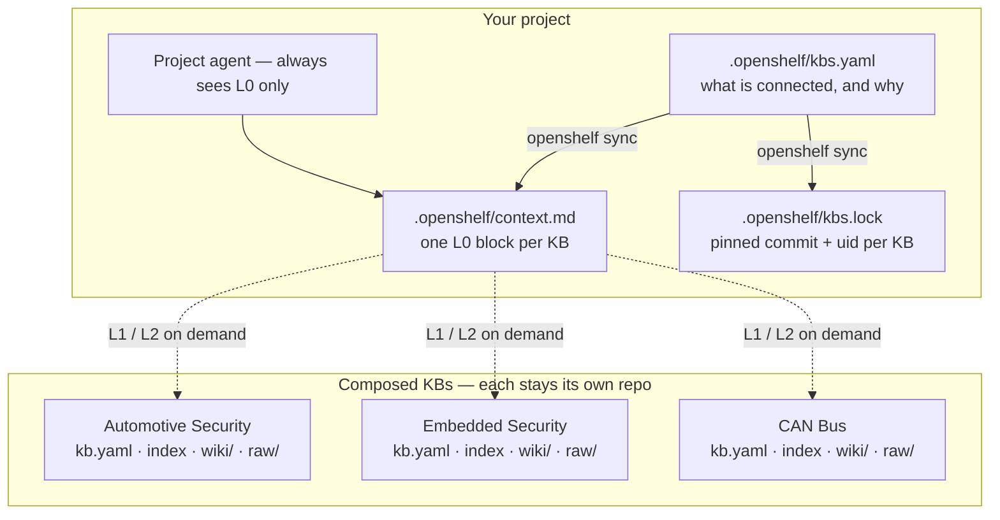
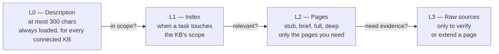
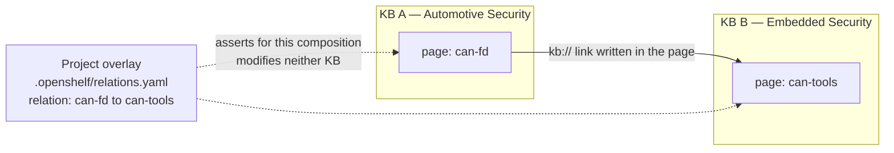

# OpenShelf

An open standard for the **LLM Wiki** pattern described by [Andrej Karpathy](https://gist.github.com/karpathy/442a6bf555914893e9891c11519de94f): an LLM builds and maintains a persistent, interlinked Markdown wiki from your raw sources, so knowledge is compiled once and kept current instead of re-derived on every query.

Think of each knowledge base as a book on a project's shelf. An agent sees every spine (a one-line description), opens the table of contents (the index) when a task touches that subject, reads only the pages it needs, and checks the references (raw sources) when it has to.

The gist leaves layout, page formats and tooling open, and OpenShelf keeps it that way. It standardizes only what's needed to **connect** knowledge bases, and leaves everything else to the KB's owner:

- **A small contract.** A `kb.yaml` manifest at the root declares the KB's description and where its pages, index and sources are. Pages need only a `title` and a one-line `summary`, and are identified by their path. Links can be Markdown or Obsidian wikilinks; links into other KBs use `kb://<kb>/<page>`.
- **Free organization.** Folders, page types, naming and workflows are up to you. The spec offers conventions from the gist (default layout, page types, ingest/query/lint, log format) that you can adopt, adapt or ignore.
- **Progressive context.** Every KB offers the same four tiers: a one-line description (L0), the index (L1), pages (L2) and raw sources (L3). Agents load only as deep as the task needs, so a project can connect many KBs cheaply.
- **Connect many KBs to a project.** List them in `.openshelf/kbs.yaml`; tooling turns that into a short `context.md` the project's agent always sees.
- **Awesome lists, upgraded.** The opt-in `awesome` profile makes each list entry a sourced, cross-linked page that an LLM keeps current, while the index still reads as a classic awesome list.



*Figure 1 — A project composing three KBs. The KBs never merge; the project owns the connection, and the agent pays context only for the KBs a task actually touches.*

## Composable knowledge bases

One KB is useful on its own: a directory with a `kb.yaml`, readable in Obsidian, versioned in git, published as a site. **Composability is what happens when you put several of them together — without merging them.**

That is the core idea of OpenShelf. A KB is a self-contained, portable unit, and a project *composes* KBs the way a program composes libraries: it declares which ones it needs, pins exact versions, and uses them through a small, stable contract. The KBs stay in their own repos, under their own owners and licences. Nothing is copied in, vendored, or forked.

### What makes a KB composable

- **Self-describing.** `kb.yaml` declares the KB's `id`, description, and where its pages, index, and sources live. A consumer never has to guess a layout — it reads the manifest. (§2)
- **Addressable.** Pages link across KB boundaries with `kb://<kb-id>/<page-id>`. The link resolves when that KB is connected, falls back to the target's published `url` when it is known, and otherwise renders as plain text — so a KB can reference others without depending on them being present. A KB lists the KBs it links into in `depends`; it does not vendor them. (§4.4)
- **Identifiable, not just named.** An `id` is a human address and can change. A `uid` — a UUID minted once and never changed — is the KB's identity across renames and repo moves. Page `uid`s do the same job one level down, surviving moves within and between KBs. (§2, §4.1)
- **Cheap to add.** Every KB exposes the same progressive tiers (below), so connecting a KB costs one short L0 block in the project's always-on context — not the KB's contents. Composing twenty KBs is affordable; you pay for depth only where a task digs.
- **Safe to recompose.** `openshelf sync` pins each KB to an exact commit and records its `uid` in `kbs.lock`. A later sync *fails* if a different KB answers to a familiar `id` (a substitution), fails if two connected KBs share a `uid`, and diagnoses a changed `id` with an unchanged `uid` as what it is: a rename, to be adopted deliberately. (§6)

### Progressive context is what makes composition scale



*Figure 2 — The four context tiers (§3). Composition stays cheap because depth is opt-in, per task and per page.*

### How a composition works

1. **Declare** — the project lists its KBs in `.openshelf/kbs.yaml`, each with a source, a ref, and a `use` hint saying when that KB is relevant.
2. **Sync** — tooling fetches each KB, pins it in `.openshelf/kbs.lock` (commit + `uid`), and writes `.openshelf/context.md`: one L0 block per KB. The project's `AGENTS.md` / `CLAUDE.md` points at that file, so its agent always sees the whole shelf — and knows how to go deeper.
3. **Work read-only** — connected KBs are read-only to the project. Knowledge gained while working is contributed back to a KB through that KB's own maintenance process, in its own repo.
4. **Respect visibility** — a KB declares itself `public`, `internal`, or `private`. A non-public KB's L0 text, `use` hint, and paths are never written into the committed `context.md`; they go to a gitignored `context.local.md`, or the connection is refused. Connecting a KB never silently publishes it. (§2, §6)

### Relations without editing the sources

A composing project can also say how pages in different KBs relate — *without modifying either KB* — using a **relation overlay** that lives in the project, conventionally `.openshelf/relations.yaml`:



*Figure 3 — Two kinds of cross-KB connection: a `kb://` link a page asserts itself (§4.4), and an overlay relation only the composing project asserts (§6.1).*

Overlay types are `related` and `same-as` (symmetric), `broader` / `narrower` (inverses), and `supersedes` (directional). An overlay relation stays visibly the composition's claim, not the KB's — `same-as`, for example, records that two pages describe the same entity *for this composed view*; it never merges the pages, and each KB renders exactly as before on its own. If a KB later adopts a relation into its own pages, the overlay entry is removed, so a relation lives in exactly one layer at a time.

| Layer | Lives in | Owned by |
|---|---|---|
| A KB's pages, index, and sources | That KB's repo | The KB's maintainers |
| Connection list and `use` hints | Project's `.openshelf/kbs.yaml` | The project |
| Pinned commits and `uid`s | Project's `.openshelf/kbs.lock` | Tooling (`openshelf sync`) |
| Always-on L0 view of the shelf | Project's `.openshelf/context.md` | Tooling (`openshelf sync`) |
| Relations for one composition | Project's `.openshelf/relations.yaml` | The project |

*Who owns what in a composition. The glue belongs to the composer; the knowledge belongs to the KBs.*

The same machinery composes at every scale: a single project connecting two KBs (see [`examples/project/`](examples/project/)), a team connecting its internal KBs alongside public ones, or a registry — a KB whose pages are other KBs — such as the [awesome-kb registry](https://github.com/hexsecs/awesome-kb) of OpenShelf knowledge bases built from awesome lists.

## Contents

- [`SPEC.md`](SPEC.md): the v1.7 spec — also published, with the schemas, at [opennorms.github.io/openshelf](https://opennorms.github.io/openshelf/)
- [`CHANGELOG.md`](CHANGELOG.md): the spec's release history (every spec change bumps the version, §10)
- [`schemas/`](schemas/): JSON Schemas for `kb.yaml`, page frontmatter and `.openshelf/kbs.yaml`
- [`src/openshelf/`](src/openshelf/): the `openshelf` command-line tool
- [`examples/awesome-can-bus/`](examples/awesome-can-bus/): a small awesome-profile KB using the default layout
- [`examples/openshelf-design/`](examples/openshelf-design/): a KB with its own layout (nested folders, wikilinks, a custom page type)
- [`examples/project/`](examples/project/): a project that connects both

## Tooling

The `openshelf` command (Python 3.10+) works with any KB that meets the spec:

```sh
pip install git+https://github.com/OpenNorms/openshelf

openshelf init my-kb --description "One line saying what this KB covers."   # new KB, default layout, CC-BY-4.0
openshelf lint my-kb                                    # check it against the spec
openshelf checksums my-kb                               # generate/update the raw-source checksums manifest (refuses over drift unless --force)

cd my-project
openshelf add github:someone/some-kb --use "when the task involves X"        # connect a KB
openshelf sync                                          # fetch KBs, write .openshelf/kbs.lock and .openshelf/context.md
```

Point your project's `AGENTS.md` or `CLAUDE.md` at `.openshelf/context.md`. `openshelf sync --locked` reproduces the exact commits in the lock file.

### MCP server

`openshelf mcp` serves a project's connected KBs to any MCP client over stdio, one tier at a time:

| Tool | Tier | What it returns |
|---|---|---|
| `list_kbs` | L0 | Every KB's id, title, one-line description and `use` hint |
| `read_index(kb, subindex?)` | L1 | The KB's index (or a sub-index) and the pages it links to |
| `read_page(kb, page)` | L2 | One page's frontmatter, body and resolved links, following redirects |
| `read_source(kb, path)` | L3 | A raw source file, restricted to the KB's sources directory |
| `search(query, kb?)` | — | Matching pages with their summaries |

It is read-only and re-reads the files on every call, so edits show up without a restart. Links come back resolved, including `kb://` links into other KBs. Install it with the `mcp` extra and add it to Claude Code from your project directory:

```sh
pip install "openshelf[mcp] @ git+https://github.com/OpenNorms/openshelf"
claude mcp add --scope project openshelf -- openshelf mcp
```

Other clients take the same command, `openshelf mcp`, run from the project directory (or pass `--project <dir>`).

## Editor support

For YAML validation in editors that use the YAML language server, point a
file at its published schema with a first-line comment:

```yaml
# yaml-language-server: $schema=https://opennorms.github.io/openshelf/schemas/kb.schema.json
```

The same works for page frontmatter with `page.schema.json`, a project's
`.openshelf/kbs.yaml` with `project.schema.json`, and a relation overlay with
`relations.schema.json`, all under the same `/schemas/` base URL.

## GitHub Action

A KB repo can lint itself in CI with the composite action in this repo:

```yaml
- uses: actions/checkout@v4
- uses: OpenNorms/openshelf/action@v1
  with:
    paths: .        # KB paths to lint, space-separated
    strict: true    # optional: fail on warnings too (default false)
```

Findings appear as annotations on the offending files. The action installs
the tool from the ref it is used at, so the lint rules match the pinned
action version; set the `version` input to install a specific PyPI release
instead. This repo's own CI lints its example KBs through the action.

## Status

Stable — spec v1.7. Changes to the spec are released as new spec versions and
recorded in [`CHANGELOG.md`](CHANGELOG.md).

## Releases and versions

The package is published to PyPI as `openshelf` from tags (`vX.Y.Z`) via
trusted publishing. The tool's version and the spec version move together:
tool `X.Y.Z` fully implements spec `X.Y` (the `SPEC_VERSION` it reports),
and patch releases fix tooling without changing spec conformance. A KB that
declares `openshelf: "X.Y"` in `kb.yaml` can be used with any tool release
whose spec version is the same major version and at least that minor, per
the compatibility contract in spec §10.

## License

- **Code** (`src/`, `tests/`, `schemas/`, CI): [MIT](LICENSE).
- **Specification and examples** (`SPEC.md`, `examples/`): [CC-BY-4.0](LICENSE-SPEC).

Knowledge bases you create are yours to license. `openshelf init` defaults to CC-BY-4.0, which you can change with `--license`.
